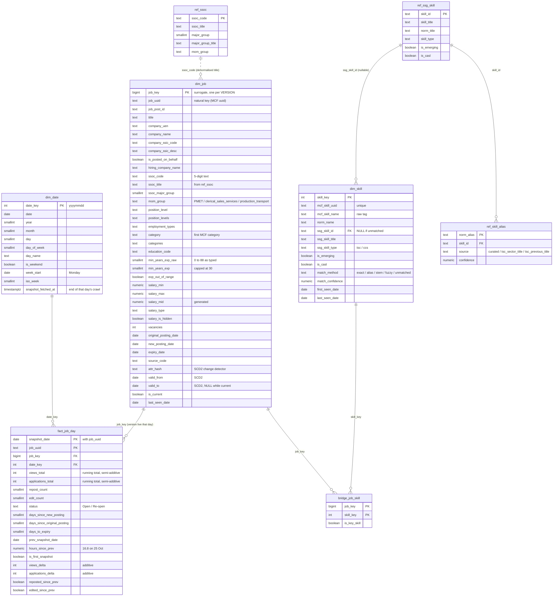

# ER diagram: clean layer (star schema)

Source of truth: `sql/init/02_clean_schema.sql`. Grain of the fact table: **one posting on one snapshot day**.
Rendered PNG: none in the repo (no Mermaid renderer available offline on the build laptop). Paste the block below
into https://mermaid.live or the GitHub markdown preview to render it, then screenshot for the report.

Operational tables outside the star (not drawn): `clean.rejected_rows` (dead letter table), `clean.load_log`
(step timings per run), `clean.dq_results` (one verdict per check per day). The raw layer stays as it was:
`raw.mcf_job_snapshots(snapshot_date, job_uuid, fetched_at, payload JSONB)` and `raw.ingest_runs`.

## Reading the diagram in Kimball's terms (L8)

| Step | Answer |
|---|---|
| 1. Business process | A posting is open on MyCareersFuture and job seekers view it and apply |
| 2. Grain | One posting on one snapshot day (`fact_job_day`) |
| 3. Dimensions | `dim_job` (what, who, which occupation: company and SSOC denormalised in), `dim_date` (when), `dim_skill` through `bridge_job_skill` (which skills) |
| 4. Facts | `views_total`, `applications_total`, `repost_count`, `edit_count` (semi-additive running totals) and `views_delta`, `applications_delta` (additive increases) |

The fact table is long and narrow (180,741 rows for two days, 19 columns), the dimensions are short and wide
(`dim_job` has 40 columns), which is the shape the lecture described.
